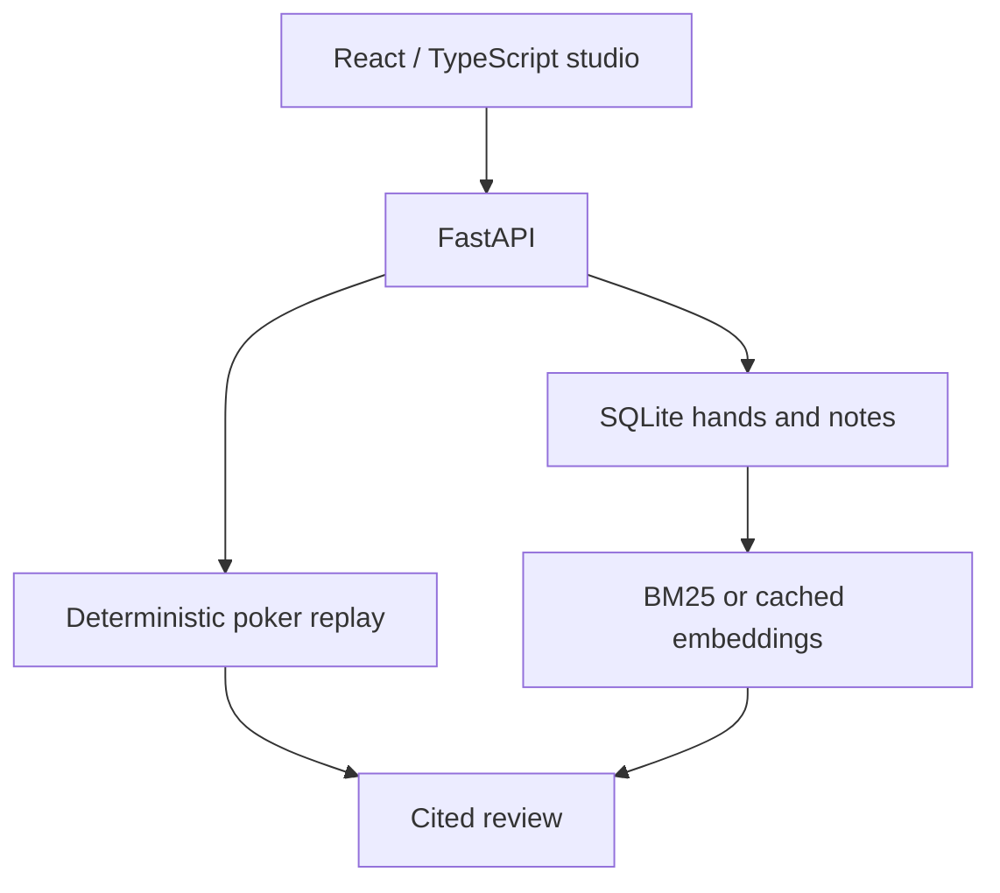

# Felt / Poker Review Copilot

A local-first, full-stack post-game review studio for nine-handed No-Limit Hold'em cash games.

## What it does

- Replays structured hands, with exact Decimal chip accounting, turn-order validation, all-in calls, short-raise reopening, uncalled refunds and side-pot eligibility.
- Captures Hero decisions before their actions; later board cards do not appear in earlier decision contexts.
- Saves hands and notes in SQLite. Exact duplicate histories cannot inflate your sample.
- Retrieves cited strategy notes using a BM25 baseline or optional cached OpenAI embeddings.
- Produces a deterministic rules summary without an API key, or an explicitly requested structured AI review with citation-ID validation.
- Converts natural-language notes into a draft JSON hand with missing-information prompts when an API key is configured.
- Shows evidence-backed decision patterns with opportunity denominators. Demo hands are excluded from personal statistics.
- Includes a React/TypeScript table replayer, saved-hand filters, JSON export, strategy notebook and responsive decision dashboard.

The problem this project addresses: hand histories are often incomplete, and an LLM can miscalculate a pot or give unsupported advice. Python is the arithmetic source of truth; retrieved notes and an optional LLM explain the evidence.

## Start on Windows

Prerequisites: Git, Python 3.11+, Node.js 22+ with npm. From the repository root:

```powershell
python -m venv .venv
.\.venv\Scripts\python.exe -m pip install -e ".[dev]"
npm --prefix frontend ci
npm --prefix frontend run build
.\.venv\Scripts\python.exe -m uvicorn poker_review.api:create_app --factory --host 127.0.0.1 --port 8000
```

Open **http://127.0.0.1:8000**. API docs: **http://127.0.0.1:8000/docs**.

You can also run `./start.ps1` if your PowerShell policy allows local scripts. Direct commands above do not require script activation or a policy change.

On macOS/Linux, replace `.venv\Scripts\python.exe` with `.venv/bin/python`.

## First session

1. The studio opens a clearly labeled synthetic QQ example; it is not saved automatically.
2. Move through the timeline to inspect pots, stacks and decision prices.
3. Save the example with the demo flag enabled, then click **規則摘要** to inspect retrieved references.
4. Use **記錄牌局** to edit a JSON history. Change its ID and all relevant details for your own hand. Uncheck the demo flag only for actual personal hands.
5. Save personal hands and visit **決策趨勢**. Counts represent only the hands you chose to record.

The editor validates a complete nine-player roster. Unknown stacks, suits or missing actions must be confirmed rather than guessed. Natural-language AI extraction is a draft that still requires user review and deterministic validation.

## Optional AI and semantic retrieval

Copy `.env.example` to `.env` and set `OPENAI_API_KEY`. Restart the backend. The key stays on the server and is never returned to the browser. Never prefix it with `VITE_`.

- `OPENAI_MODEL`: structured review/extraction model; defaults to `gpt-4.1-mini`, subject to your account's access.
- `POKER_RETRIEVAL=bm25`: local lexical retrieval, no paid network requests.
- `POKER_RETRIEVAL=openai`: real semantic retrieval through `text-embedding-3-small` (configurable).
- Embeddings are cached by model and text digest in SQLite; changed text gets a new cache entry.
- OpenAI requests use timeouts, bounded retries, structured parsing and explicit errors. An unavailable provider is never represented as a successful AI result.

AI review, extraction, and semantic indexing/querying can incur provider charges. Enabling semantic retrieval sends note chunks and search queries to the embedding provider. Live reviews send computed decision facts and retrieved references. Provider calls happen only during the relevant requested operation; startup does not call OpenAI.

## Development

Backend:

```powershell
.\.venv\Scripts\python.exe -m uvicorn poker_review.api:create_app --factory --reload --host 127.0.0.1 --port 8000
```

Frontend, in another terminal:

```powershell
npm --prefix frontend run dev
```

Open http://127.0.0.1:5173. Vite proxies `/api` to the backend.

## Validation

```powershell
.\.venv\Scripts\python.exe -m pytest -q
.\.venv\Scripts\python.exe -m poker_review.evaluate
npm --prefix frontend run build
cd frontend
npx playwright install chromium
npm run test:e2e
```

Playwright launches both servers when needed. Run it with no personal server on those ports to isolate the test database. Tests use synthetic histories and no paid API calls.

The retrieval evaluation contains ten handwritten query/source pairs over the six original educational notes. It is a small regression test, **not** a poker-strategy benchmark or proof of real-world retrieval quality. AI provider contracts are tested using mocks; actual paid model output requires your configured credentials.

## Docker

```sh
docker compose up --build
```

Open http://127.0.0.1:8000. A named volume persists SQLite data across container restarts. Do not delete the volume if you want to retain your hands.

## Architecture and learning



- [Architecture, tradeoffs and interview discussion](docs/architecture.md)
- [Learning walkthrough after using the complete app](docs/walkthrough.md)
- [Validation record and limits](docs/validation.md)
- [Original Lesson 1: schema](docs/lesson-01.md)
- [Original Lesson 2: replay milestone](docs/lesson-02.md)

The original lessons describe their historical scope. The full application extends the replay engine to all-ins and pot layers.

## Honest boundaries

- Nine occupied seats, fixed position labels and standard blinds. Antes, straddles, rake, dead blinds, house-rule exceptions and showdown hand evaluation are not implemented.
- Stacks may differ and all-ins are supported; side pots are calculated, but winners are not selected and payouts are not performed.
- Betting completion is separate from a fully recorded board or known showdown result.
- A call price is not hand equity. It cannot by itself tell you whether a call is profitable.
- Pattern thresholds are transparent heuristics, not solver verdicts, statistical confidence or proof of a leak.
- Strategy seed notes are original educational summaries, not solver outputs. Source IDs prove traceability, not factual correctness.
- This is a single-user local application. It has no authentication or multi-user authorization and should not be exposed directly to the public internet.
- SQLite is a deliberate small-project default. PostgreSQL/pgvector is a possible scaling step, not a dependency claimed by this implementation.
